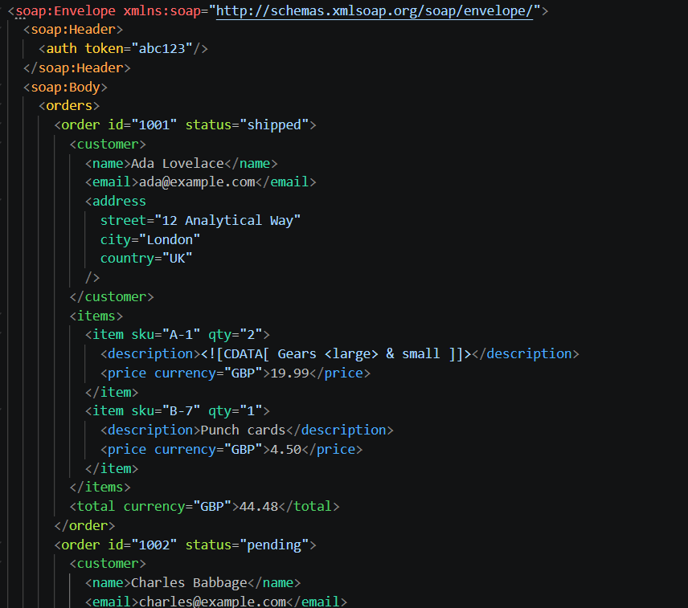

# Rainbow XML

A VS Code extension that colors XML tags by how deeply they are nested, the way rainbow brackets color nested parentheses. The root element is red, its children are orange, their children yellow, and so on through the rainbow, wrapping back to red after pink. Opening and closing tags share a color, and attribute names match their tag. No setup needed.



It also:

- **Colors by name instead, if you prefer.** With `"rainbowXml.colorBy": "name"`, every `<order>` is the same color in every file, whatever its depth.
- **Highlights the matching tag.** Put the cursor on a tag name and its opening or closing partner is highlighted, even thousands of lines away.
- **Marks unmatched tags.** Opening tags that are never closed and closing tags with nothing to close get a wavy underline, a hover message, and a mark on the scrollbar.
- **Understands HTML.** Add `html` to `rainbowXml.languages` and void elements like `<br>` need no closing tag, tag names ignore case, and `<script>` and `<style>` contents are skipped.
- **Works in the browser.** It runs on [vscode.dev](https://vscode.dev) and github.dev as well as desktop VS Code.

## Usage

Open any file that VS Code shows as XML (the language name in the bottom-right corner of the window) and its tags are colored. That covers `.xml`, `.xsd`, `.svg`, `.csproj`, and many other XML-based formats.

For other files:

- **A different language mode**, like XSL, HTML, or one added by another extension: add its language ID to `rainbowXml.languages`. Run **Change Language Mode** from the Command Palette to see each ID in parentheses.
- **A file extension VS Code doesn't recognize as XML**: tell VS Code to open it as XML.

  ```jsonc
  "files.associations": {
    "*.mydata": "xml"
  }
  ```

- **Just this one file**: run **Rainbow XML: Toggle** from the Command Palette. It turns coloring on or off for the current file only, until the file is closed. In files that are already colored, it's also in the right-click menu under **Rainbow XML**.

To give Toggle a keyboard shortcut, run **Preferences: Open Keyboard Shortcuts (JSON)** and add:

```jsonc
{ "key": "ctrl+alt+r", "command": "rainbowXml.toggle", "when": "editorTextFocus" }
```

## Settings

| Setting | Default | What it does |
| --- | --- | --- |
| `rainbowXml.enabled` | `true` | Turns coloring on or off |
| `rainbowXml.colorBy` | `"depth"` | `"depth"` colors by nesting level; `"name"` gives each tag name its own color |
| `rainbowXml.palette` | `[]` (theme colors) | A custom list of hex colors to use instead, the same in every theme |
| `rainbowXml.colorAttributes` | `true` | Also colors attribute names to match their tag (values keep their normal color) |
| `rainbowXml.colorBrackets` | `false` | Also colors the `<`, `>`, and `/` around each tag |
| `rainbowXml.highlightMatchingTag` | `true` | Highlights the tag under the cursor and its partner |
| `rainbowXml.markUnmatchedTags` | `true` | Underlines tags that are never closed or have nothing to close |
| `rainbowXml.overrides` | `{}` | Pins specific tag names to specific colors, e.g. `{ "order": "#ff0000" }` |
| `rainbowXml.languages` | `["xml"]` | Language modes to color (e.g. `xaml`, `svg`, `xsl`, `html`) |

Command: **Rainbow XML: Toggle** turns coloring on or off for the current file. It's in the Command Palette and the editor's right-click menu.

## Colors and themes

The built-in palette is made of theme colors, with separate light, dark, and high contrast variants. Themes can restyle them, and so can you, for every theme or just one:

```jsonc
"workbench.colorCustomizations": {
  "rainbowXml.color1": "#ff5555",            // root elements, every theme
  "[Solarized Light]": {
    "rainbowXml.color2": "#cb4b16"           // children of the root, one theme only
  },
  "rainbowXml.matchingTagBackground": "#ffffff22",
  "rainbowXml.unmatchedTag": "#ff0000"
}
```

| Color | Default | Used for |
| --- | --- | --- |
| `rainbowXml.color1` … `rainbowXml.color10` | red, orange, yellow, lime, green, teal, sky, indigo, violet, pink | Tag colors, in nesting order |
| `rainbowXml.matchingTagBackground` | `editorBracketMatch.background` | Background of the matched tag pair |
| `rainbowXml.matchingTagBorder` | `editorBracketMatch.border` | Border around the matched tag pair |
| `rainbowXml.unmatchedTag` | `editorWarning.foreground` | Underline and scrollbar mark for unmatched tags |

Setting `rainbowXml.palette` replaces the ten theme colors with your own list.

## Large files

Only the visible lines (plus 100 above and below) are painted, and after an edit only the lines from the edit down are rescanned, so a 64,000-line file stays smooth to scroll and type in.

Two size limits apply:

- **Lines over 20,000 characters are skipped.** XML minified onto a single line won't be colored. Format the file first (for example with the XML extension below) and it will be.
- **Files over 50 MB stay uncolored.** VS Code doesn't hand files that large to extensions at all.

## Limitations

- **Rainbow XML colors tags; it doesn't validate them.** It doesn't check your XML against a schema or DTD. Unmatched-tag marks only catch tags that don't pair up.
- **HTML's optional closing tags aren't understood.** HTML lets you leave out tags like `</li>` and `</p>`, but Rainbow XML still expects them and marks those elements as never closed.

## How it works

1. **Find tags.** A regular expression scans the visible lines (plus a 100-line buffer) for opening, closing, and self-closing tags. Comments, CDATA, and `<?...?>` / `<!...>` declarations are skipped.
2. **Track nesting.** A tag's depth is the number of elements open around it, and it picks the palette color at that position. A closing tag closes back to the nearest open element with the same name, so one unclosed tag doesn't shift every color after it. Elements closed this way are the unmatched tags.
3. **Save checkpoints.** Depth depends on everything above the visible lines, so the whole file is scanned once and the open elements are saved every 256 lines, along with the shallowest nesting reached before the next checkpoint. After an edit, only the lines from the edit down are scanned again, and painting starts from the nearest checkpoint.
4. **Find matching tags.** A closing tag remembers where its opening tag was. For an opening tag, the search skips every 256-line section where the nesting never gets shallow enough to close it, so a match at the far end of a 64,000-line file takes under a millisecond.
5. **Apply decorations.** One decoration type per palette color, created once and reused. `setDecorations` paints tag names over the normal syntax colors.

Rescans are debounced by 100 ms.

## Related extensions

- [XML by Red Hat](https://marketplace.visualstudio.com/items?itemName=redhat.vscode-xml) validates XML against schemas, formats it, and adds autocomplete. It works alongside Rainbow XML.

## Credits

Inspired by [Rainbow CSV](https://marketplace.visualstudio.com/items?itemName=mechatroner.rainbow-csv) by mechatroner, which colors each CSV column differently to make the columns easier to tell apart. Rainbow XML does the same for XML nesting.

## Contributing

Bug reports are welcome in [GitHub issues](https://github.com/Zalanshah64/rainbow-xml/issues), and questions and ideas in [Discussions](https://github.com/Zalanshah64/rainbow-xml/discussions). To build and test it yourself, see [CONTRIBUTING.md](CONTRIBUTING.md).
